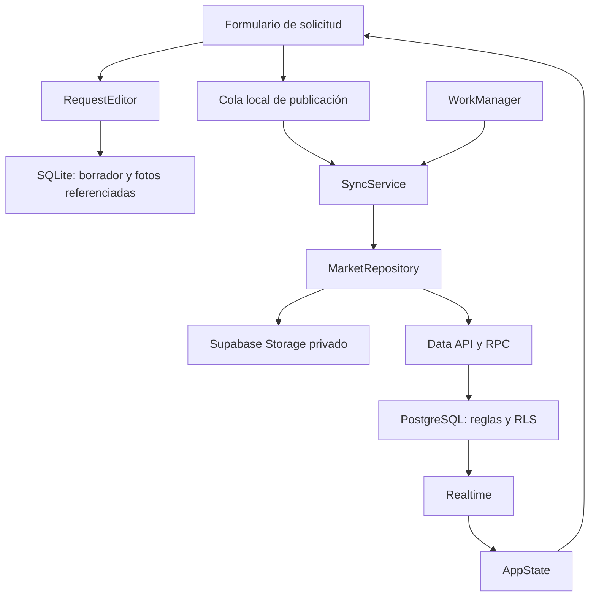

# Encárgalo

**Tus ideas, en manos de negocios de Piura.**

Encárgalo es una aplicación Android que conecta a personas que necesitan productos personalizados con negocios de estampado, bordado, impresión y otros trabajos por encargo. El cliente describe lo que necesita, adjunta referencias, recibe cotizaciones y elige una propuesta. El negocio cotiza y actualiza el avance del pedido hasta su entrega.

Proyecto del curso **Tecnología y Desarrollo Móvil**. Docente: **Taype Cruzado Henry Mitchell**. La implementación pone énfasis en el acceso a cámara y GPS de la semana 13 y los integra con persistencia local, APIs, autenticación y procesos en segundo plano.

[Descargar APK](https://github.com/pulacheJJ/Encargalo/releases/tag/v1.1.0) · [Ver código](https://github.com/pulacheJJ/Encargalo) · [Reportar un problema](https://github.com/pulacheJJ/Encargalo/issues)

## Contenido

- [Funciones principales](#funciones-principales)
- [Instalar la aplicación](#instalar-la-aplicación)
- [Cómo usar Encárgalo](#cómo-usar-encárgalo)
- [Tecnologías](#tecnologías)
- [Ejecutar desde el código](#ejecutar-desde-el-código)
- [Configurar el backend](#configurar-el-backend)
- [Arquitectura](#arquitectura)
- [Cámara y ubicación](#cámara-y-ubicación)
- [Datos y sincronización](#datos-y-sincronización)
- [Relación con el sílabo](#relación-con-el-sílabo)
- [Pruebas](#pruebas)
- [Generar APK y App Bundle](#generar-apk-y-app-bundle)
- [Problemas frecuentes](#problemas-frecuentes)
- [Video y evidencias](#video-y-evidencias)
- [Mejoras pendientes](#mejoras-pendientes)
- [Colaboración y créditos](#colaboración-y-créditos)

## Funciones principales

| Cliente | Negocio |
| --- | --- |
| Crear una cuenta y editar su perfil. | Crear una cuenta con perfil comercial y categorías de trabajo. |
| Preparar solicitudes con descripción, cantidad, distrito y fecha. | Consultar solicitudes disponibles según su categoría. |
| Tomar fotos o elegir hasta tres imágenes de referencia. | Revisar referencias y enviar cotizaciones con precio, condiciones y fecha. |
| Confirmar un punto de entrega mediante ubicación o escribir una referencia manual. | Consultar el punto de entrega de los pedidos adjudicados. |
| Comparar cotizaciones y aceptar una propuesta. | Actualizar el avance de sus pedidos. |
| Consultar pedidos, avisos e historial. | Consultar cotizaciones, pedidos y avisos. |

La aplicación también incluye borradores locales, una cola de envíos pendientes, notificaciones push y registro de pagos y cancelaciones **simulados**. Los pagos sirven para representar adelanto, saldo, rechazo y devolución; no se transfiere dinero ni se conecta una billetera o tarjeta.

## Instalar la aplicación

1. Abre la [publicación v1.1.0](https://github.com/pulacheJJ/Encargalo/releases/tag/v1.1.0) y descarga la APK desde **Assets**.
2. En Android, abre el archivo y concede a la aplicación desde la que lo abriste el permiso para instalar aplicaciones, si el sistema lo solicita.
3. Instala y abre **Encárgalo**. Necesitas conexión a Internet para crear una cuenta y comunicarte con el backend.
4. Crea una cuenta de cliente o negocio. Si se solicita confirmar el correo, completa ese paso antes de iniciar sesión.

**Versión declarada en el código:** `1.1.0+4`. **Android mínimo:** 7.0, API 24. **Identificador:** `pe.edu.unp.encargalo`.

Para actualizar una instalación existente y conservar sus datos, utiliza una APK con la misma firma y una versión compatible. Conserva la firma original del equipo. Los emuladores permiten probar la interfaz; documenta si la cámara o la ubicación utilizadas son simuladas.

## Cómo usar Encárgalo

### Como cliente

1. Completa tu perfil y crea una solicitud.
2. Indica el producto, los detalles, la cantidad, el distrito y la fecha deseada.
3. Adjunta fotos de referencia y, si corresponde, confirma el punto de entrega o escribe una dirección de referencia.
4. Revisa y publica. Una solicitud pendiente de envío todavía no está confirmada en la nube.
5. Compara las cotizaciones recibidas y acepta una.
6. Consulta el avance del pedido y confirma su recepción cuando corresponda.

### Como negocio

1. Completa el perfil comercial y selecciona tus categorías.
2. Revisa una solicitud disponible y prepara una cotización con importe, fecha, vigencia y condiciones.
3. Cuando el cliente la acepte, consulta el pedido y sus datos de entrega.
4. Actualiza el avance según las transiciones permitidas. El flujo principal es **Confirmado → En producción → Listo → Entregado**; el servidor comprueba el rol y las condiciones de cada transición.

## Tecnologías

| Área | Implementación |
| --- | --- |
| Interfaz y estado | Flutter, Dart, Material 3 y Provider. |
| Backend | Supabase Auth, PostgreSQL, Data API, Realtime y Storage privado. |
| HTTP y JSON | `http`, modelos Dart y operaciones RPC del servidor. |
| Persistencia local | SQLite (`sqflite`) y SharedPreferences. |
| Sesión | `flutter_secure_storage`, con almacenamiento protegido en Android. |
| Cámara e imágenes | `image_picker` y procesamiento con `image`. |
| Ubicación | `geolocator` y apertura de mapas externos con `url_launcher`. |
| Push | Firebase Cloud Messaging y notificaciones locales. |
| Segundo plano | WorkManager para sincronización diferida. |
| Pruebas | Flutter Test, SQLite FFI y PostgreSQL WASM mediante PGlite. |

Supabase proporciona autenticación y datos. Firebase se utiliza para mensajería. La entrega se diseñó para Supabase Free y Firebase Spark; su disponibilidad está sujeta a las cuotas de esos servicios.

## Ejecutar desde el código

### 1. Preparar el entorno

El entorno documentado para la entrega utiliza **Flutter 3.29.3 / Dart 3.7.2**, **JDK 21**, Android SDK con plataforma 35 y NDK `27.0.12077973`. Las dependencias están registradas en [pubspec.yaml](pubspec.yaml) y [pubspec.lock](pubspec.lock). Node.js 20 se utiliza para las pruebas del backend; Supabase CLI y Deno se necesitan para administrar el backend y sus funciones.

```powershell
git clone https://github.com/pulacheJJ/Encargalo.git
cd Encargalo
flutter --version
flutter doctor -v
flutter pub get
```

Si utilizas otra versión de Flutter, revisa la compatibilidad de las dependencias antes de cambiar el archivo de bloqueo. En particular, la versión de `intl` debe ser compatible con `flutter_localizations` del SDK elegido.

### 2. Preparar la configuración del cliente

Desde la raíz del proyecto, copia la plantilla:

```powershell
Copy-Item config/public.example.json config/public.json
```

Completa el archivo con la configuración del backend que utilizarás:

| Variable | Contenido |
| --- | --- |
| `SUPABASE_URL` | URL HTTPS del proyecto Supabase. |
| `SUPABASE_ANON_KEY` | Clave pública del cliente: publishable o anon, según el proyecto. |
| `FIREBASE_API_KEY` | Clave de configuración del cliente Firebase. |
| `FIREBASE_APP_ID` | Identificador de la aplicación Firebase. |
| `FIREBASE_PROJECT_ID` | Identificador del proyecto Firebase. |
| `FIREBASE_SENDER_ID` | Identificador del remitente FCM. |

Los dos campos de Supabase habilitan la conexión principal. Los cuatro campos de Firebase se utilizan para push y pueden dejarse vacíos si vas a trabajar sin esa función. Comprueba que el backend tenga las migraciones y el catálogo territorial antes de probar el flujo completo.

`config/public.json` está excluido de Git. Contiene configuración del cliente, no claves administrativas. Las claves `service_role`, las claves privadas de cuentas de servicio y el secreto del emisor push pertenecen exclusivamente al servidor.

### 3. Preparar la firma y ejecutar

**Condición de la configuración actual:** [android/app/build.gradle.kts](android/app/build.gradle.kts) exige `android/key.properties` al configurar Gradle, incluso si vas a ejecutar en modo debug. Prepara la firma antes de usar `flutter run`.

- **Trabajo sobre la entrega del equipo:** obtén la configuración de firma mediante el canal privado del equipo y comprueba la ruta de `storeFile` en tu computadora.
- **Instalación independiente con una firma nueva:** con `JAVA_HOME` configurado, puedes ejecutar `powershell -NoProfile -File tools/create-signing.ps1`. El script crea una firma solo si todavía no existe. Esa firma nueva no permite actualizar la APK original del equipo.

Después de completar la configuración y la firma:

```powershell
flutter devices
flutter run --dart-define-from-file=config/public.json
```

Selecciona un dispositivo Android. Sin la configuración de Supabase, la aplicación muestra una pantalla de conexión pendiente.

## Configurar el backend

Para trabajar con el backend existente del equipo, solicita sus identificadores públicos y utiliza el entorno ya desplegado. Los siguientes pasos son una referencia para preparar **un proyecto propio de desarrollo**, con acceso administrativo a ese proyecto.

### Base de datos, autenticación y catálogo

1. Crea el proyecto Supabase y configura Auth para permitir registro y confirmación por correo. Añade `encargalo://auth` a las redirecciones autorizadas. Revisa también la configuración de correo para recuperación de contraseña.
2. Con la CLI de Supabase instalada, vincula el proyecto y revisa/aplica las migraciones versionadas:

   ```powershell
   supabase login
   supabase link --project-ref TU_PROJECT_REF
   supabase db push --dry-run
   supabase db push
   ```

3. Comprueba las tablas, las políticas RLS, el bucket privado `references` y las tablas incluidas en Realtime. Su definición está en [supabase/migrations](supabase/migrations).
4. Carga en `public.locations` las filas de `locations` de [assets/locations/peru.json](assets/locations/peru.json), utilizando los campos `code`, `region`, `province` y `district`. El formulario tiene un catálogo local, pero el servidor necesita su propia copia para validar las operaciones.
5. Crea las cuentas desde la aplicación para que se generen sus perfiles mediante el flujo de registro.

El script [tools/seed-locations.ts](tools/seed-locations.ts) carga el catálogo del equipo, pero actualmente verifica un proyecto Supabase específico. Para usar otro proyecto, adapta y revisa esa herramienta antes de ejecutarla. Varias herramientas de despliegue y compilación tienen restricciones similares.

Referencia: [gestión de entornos y migraciones de Supabase](https://supabase.com/docs/guides/deployment/managing-environments).

### Búsqueda de referencias y notificaciones

- **Geocodificación:** despliega `geocode` y configura `GEOCODER_CONTACT` como secreto del servidor. La función consulta Nominatim con caché y control de frecuencia; acepta una lista limitada de distritos de Piura, no direcciones personales.
- **Push:** configura Firebase para el identificador Android de la app, completa los cuatro campos del cliente y prepara una cuenta de servicio con permiso de envío FCM. Su JSON privado se guarda en los secretos del servidor como `FCM_SERVICE_ACCOUNT_JSON`; añade también `PUSH_DISPATCH_SECRET`.
- **Emisor:** [dispatch-push](supabase/functions/dispatch-push/index.ts) comprueba actualmente una identidad Firebase concreta del equipo. Ajusta esa comprobación si preparas otro proyecto.
- **Programación:** revisa [supabase/setup_push_schedule.sql](supabase/setup_push_schedule.sql). Requiere `pg_cron`, `pg_net` y las entradas de Vault `encargalo_push_url` y `encargalo_push_secret`; el valor del secreto debe coincidir con el del emisor.

Una vez preparada la configuración del servidor, los comandos de despliegue de funciones son:

```powershell
supabase functions deploy geocode --project-ref TU_PROJECT_REF
supabase functions deploy dispatch-push --project-ref TU_PROJECT_REF
```

[supabase/config.toml](supabase/config.toml) desactiva la comprobación JWT de la plataforma para estas funciones. `geocode` valida la sesión dentro de su código; `dispatch-push` exige un secreto de despacho. Conserva esas comprobaciones al modificar el despliegue.

Referencia: [despliegue de Edge Functions](https://supabase.com/docs/guides/functions/deploy).

## Arquitectura

El proyecto se organiza por funcionalidades. Las carpetas `presentation`, `domain` y `data` separan responsabilidades donde ya se ha aplicado esa división; los servicios compartidos viven en `core`.

```text
lib/
├── main.dart                 Inicio y navegación raíz
├── app/                      Composición, sesión, estado global y tema
├── core/
│   ├── async/                Agrupación de operaciones concurrentes
│   ├── background/           Sincronización y WorkManager
│   ├── device/               Servicios de cámara y ubicación
│   ├── domain/               Modelos compartidos y validaciones
│   ├── network/              HTTP, errores y caché de consultas
│   ├── notifications/        Recepción y presentación de avisos
│   ├── storage/              SQLite, borradores y cola
│   └── widgets/              Componentes compartidos
└── features/
    ├── auth/                 Acceso, registro y recuperación
    ├── home/                 Inicio y navegación por rol
    ├── locations/            Catálogo territorial y selección
    ├── marketplace/          Solicitudes, cotizaciones y pedidos
    ├── payments/             Pagos y cancelaciones simulados
    ├── profile/              Perfil y preferencias
    └── requests/             Edición de solicitudes

supabase/                     Migraciones, funciones y programación push
test/                         Pruebas Dart y Flutter
backend-tests/                Pruebas aisladas de reglas PostgreSQL
tools/                        Herramientas de preparación y entrega
```



El diagrama muestra el recorrido de una solicitud. La implementación también contiene accesos desde pantallas a repositorios y almacenamiento; la separación en capas todavía puede ampliarse. Las reglas que autorizan publicaciones, cotizaciones, pagos y cambios de estado se comprueban en el servidor.

## Cámara y ubicación

### Cámara

[CameraService](lib/core/device/hardware_services.dart) utiliza `image_picker` para abrir la cámara o la galería. La imagen se orienta, reduce a un máximo de 1600 píxeles por lado y comprime a JPEG. Se retiran los metadatos EXIF y se guarda una copia dentro del almacenamiento de la aplicación. Cada solicitud admite hasta tres imágenes preparadas de hasta 2 MB.

El borrador se guarda antes de abrir el selector. Si Android interrumpe la actividad, la aplicación intenta recuperar la imagen mediante `retrieveLostData()`. Al publicar, las imágenes se suben a Storage privado y se consultan mediante enlaces temporales.

**Relación con la teoría:** acceso al dispositivo mediante un plugin, operaciones asíncronas, procesamiento de imágenes, ciclo de vida y persistencia de archivos.

### GPS/localización

[LocationService](lib/core/device/hardware_services.dart) comprueba si la ubicación está activada, consulta o solicita permisos y obtiene una lectura con `geolocator`. Conserva latitud, longitud, precisión, fecha y condición de ubicación aproximada. El usuario revisa el resultado y confirma el punto antes de incorporarlo al borrador.

El mapa se abre en una aplicación externa, con alternativa web en OpenStreetMap. Si no se concede permiso o no se obtiene una lectura, se puede continuar con una referencia escrita. La ubicación precisa de entrega queda accesible al cliente y al negocio elegido para el pedido, según las reglas del servidor.

**Relación con la teoría:** servicios de ubicación, permisos en ejecución, incertidumbre de la medición, manejo de errores y protección de datos según el rol.

## Datos y sincronización

- **SQLite** conserva borradores, referencias a fotos, operaciones pendientes, eventos ya vistos y determinadas cachés.
- **SharedPreferences** conserva preferencias como tema, identificador del dispositivo y activación de avisos.
- **El almacén seguro** conserva la sesión del SDK. La aplicación no guarda contraseñas en SQLite.
- **Supabase** conserva cuentas, perfiles, solicitudes publicadas, cotizaciones, pedidos, historial y registros comerciales simulados.

Una publicación entra en una cola local. `SyncService` intenta enviarla y WorkManager permite diferir el trabajo hasta que haya conectividad. Los reintentos utilizan identificadores de operación y versiones para reducir duplicados y detectar conflictos. La pantalla de sincronización permite consultar pendientes y reintentar.

Un borrador local o un envío pendiente no equivale a una operación confirmada. Aceptar una cotización, registrar un pago o cambiar estados requiere confirmación del servidor. La caché actual no ofrece consulta completa de todos los pedidos sin conexión.

Realtime actualiza las consultas de la interfaz. Push utiliza un recorrido diferente: evento del servidor → cola de avisos → Edge Function → FCM → dispositivo. Android decide cuándo permite ejecutar trabajo diferido; un cierre forzado puede detenerlo hasta volver a abrir la app.

## Relación con el sílabo

| Semana o tema | Aplicación en Encárgalo | Evidencia en el código |
| --- | --- | --- |
| 1–2: plataforma, SDK y entorno | Aplicación Flutter para Android y configuración de compilación. | [pubspec.yaml](pubspec.yaml), [android](android). |
| 3: interfaz y usabilidad | Material 3, formularios, tema claro/oscuro y pantallas por rol. | [theme.dart](lib/app/theme.dart), [features](lib/features). |
| 5–6: navegación, ciclo de vida y eventos | Navegación, guardado del borrador y acciones del usuario. | [main.dart](lib/main.dart), [editor de solicitudes](lib/features/requests/presentation/request_editor_screen.dart). |
| 7: persistencia local | SQLite y preferencias. | [local_database.dart](lib/core/storage/local_database.dart), [app_state.dart](lib/app/app_state.dart). |
| 9–10: HTTP, asincronía, JSON y REST | Consultas HTTP, modelos tipados, manejo de errores y geocodificación. | [api_client.dart](lib/core/network/api_client.dart), [models.dart](lib/core/domain/models.dart), [geocode](supabase/functions/geocode/index.ts). |
| 11: BaaS | Autenticación, base PostgreSQL, almacenamiento y Realtime con Supabase. | [auth](lib/features/auth), [migraciones](supabase/migrations), [app_state.dart](lib/app/app_state.dart). |
| **13: cámara y GPS/localización** | **Fotos de referencia y punto de entrega con permisos, precisión y confirmación.** | **[hardware_services.dart](lib/core/device/hardware_services.dart), [request_editor.dart](lib/features/requests/presentation/request_editor.dart).** |
| 14: push y segundo plano | FCM, notificaciones locales y sincronización con WorkManager. | [push_service.dart](lib/core/notifications/push_service.dart), [sync_service.dart](lib/core/background/sync_service.dart), [dispatch-push](supabase/functions/dispatch-push/index.ts). |
| 15: pruebas, optimización y publicación | Pruebas automatizadas, compresión de imágenes y preparación de APK/AAB firmados. La publicación en tienda requiere su propio proceso. | [test](test), [backend-tests](backend-tests), [build-android.ps1](tools/build-android.ps1). |
| 16: sustentación del proyecto | Demostración del flujo entre cliente y negocio, con explicación de teoría, hardware y arquitectura. | Video y evidencias del equipo. |

Las semanas de evaluación no representan funcionalidades adicionales. La tabla indica dónde se aplican los contenidos; la demostración debe acompañarse con evidencias de funcionamiento.

## Pruebas

Desde la raíz, con las dependencias instaladas:

```powershell
flutter analyze
flutter test --reporter expanded
```

Para las pruebas aisladas del backend:

```powershell
cd backend-tests
npm ci
npm test
cd ..
```

Las pruebas incluyen dinero y estados, HTTP/JSON, separación entre cuentas, persistencia, cola, sesión segura, formularios y reglas comerciales. Las pruebas de PostgreSQL usan PGlite y preparan infraestructura de prueba; no se conectan al backend del producto. Las pruebas del editor usan dobles de cámara y ubicación.

Para comprobar las funciones del dispositivo, realiza además este recorrido:

1. Crear una solicitud con una foto recién tomada y un punto de entrega confirmado.
2. Cerrar y volver a abrir la aplicación para revisar el borrador.
3. Publicar y comprobar la solicitud desde una cuenta de negocio.
4. Enviar y aceptar una cotización; consultar el avance del pedido.
5. Probar ubicación desactivada, permiso rechazado y un envío sin conexión.
6. Comprobar avisos y apertura del destino de la notificación con la app en segundo plano.

Registra versión de APK, dispositivo, versión de Android, pasos y resultado. En un emulador, indica qué entradas fueron simuladas. La validación del emisor FCM no demuestra por sí sola la recepción de una notificación en un teléfono.

## Generar APK y App Bundle

Con la configuración pública y la firma preparadas:

```powershell
flutter build apk --release --dart-define-from-file=config/public.json
flutter build appbundle --release --dart-define-from-file=config/public.json
```

Archivos esperados después de una compilación correcta:

- APK: `build/app/outputs/flutter-apk/app-release.apk`.
- AAB: `build/app/outputs/bundle/release/app-release.aab`.

La APK permite instalar manualmente. El AAB es un artefacto para distribución mediante Google Play; generarlo no equivale a publicar en la tienda.

En Windows, [tools/build-android.ps1](tools/build-android.ps1) prepara una copia de compilación para resolver problemas de rutas con caracteres especiales. Ese script está adaptado a los proyectos y a la firma del equipo. Las herramientas de empaquetado y verificación también utilizan una carpeta hermana `encargalo_documentacion`, que no está incluida en el repositorio. Revisa esos requisitos antes de utilizarlas en otro entorno.

## Problemas frecuentes

| Situación | Qué revisar |
| --- | --- |
| Aparece “Conexión cloud pendiente”. | Completa los campos de Supabase y ejecuta con `--dart-define-from-file=config/public.json`. |
| `flutter pub get` informa un conflicto con `intl`. | Comprueba la versión de Flutter y la compatibilidad con `flutter_localizations`. |
| Gradle informa “Falta firma release”. | Prepara `android/key.properties` y su keystore; actualmente se exige también al configurar debug. |
| No se puede actualizar la APK instalada. | Compara identificador de aplicación, versión y certificado de firma. |
| El registro exige confirmar el correo o no llega la recuperación. | Revisa Auth, redirecciones, correo no deseado, configuración SMTP y límites de envío. |
| El servidor rechaza el distrito. | Comprueba la carga del catálogo `public.locations` y que la solicitud pertenezca a Piura. |
| “Buscar referencia del distrito” rechaza una ubicación seleccionable. | El catálogo es más amplio que la lista admitida por `geocode`; utiliza referencia manual o amplía esa lista. |
| No se obtiene ubicación. | Revisa permisos, servicio de ubicación y condiciones de recepción; en emulador, revisa su ubicación configurada. |
| No llegan notificaciones. | Revisa permiso del dispositivo, activación de avisos, configuración Firebase, token, emisor y programación del servidor. |
| Una operación continúa pendiente. | Consulta Sincronización. Verifica sesión, conectividad y mensaje del servidor antes de reenviar. |

## Video y evidencias

**Video de demostración: pendiente de añadir el enlace del equipo.**

La demostración debe mostrar cámara y ubicación dentro de una solicitud y continuar con el recorrido cliente → negocio → cotización → pedido. Explica qué hace el hardware, cómo se procesa el resultado y dónde se guarda.

Para completar este apartado, añade capturas de la solicitud con foto, revisión del punto de entrega, cotización y seguimiento. Usa datos de prueba y registra si se trata de un teléfono físico o de un emulador. El equipo ha reportado una prueba satisfactoria del recorrido principal; las capturas y los datos del dispositivo deben acompañar esa evidencia.

Los informes y registros de la entrega anterior se conservan fuera del repositorio, en `../encargalo_documentacion/`. Para que el profesor pueda consultarlos desde GitHub, añade los materiales públicos al repositorio o publica un enlace accesible en este apartado.

## Mejoras pendientes

- Extender la separación entre pantallas, controladores y repositorios en cotizaciones y pedidos.
- Ampliar la consulta local de pedidos y cotizaciones cuando no haya conexión.
- Renovar enlaces de imágenes caducados y ofrecer reintento en el visor.
- Unificar la cobertura del catálogo territorial y la búsqueda de referencias.
- Añadir pruebas de integración del flujo completo y ejecución automática en GitHub.
- Facilitar el inicio desde una copia limpia: versión de SDK fijada, configuración de firma para desarrollo y herramientas adaptables a otro backend.
- Completar el video, las capturas y la documentación del proceso de publicación.

## Colaboración y créditos

Para proponer un cambio, crea una rama, explica el problema y adjunta cómo lo verificaste. Mantén la organización por funcionalidades y ejecuta las pruebas que correspondan a tu cambio. Las reglas de autorización y los estados comerciales deben seguir comprobándose en el servidor.

Para reportar un error, indica versión de la aplicación, dispositivo, pasos, resultado esperado y resultado observado. Añade una captura si ayuda a reproducirlo.

El catálogo territorial está basado en `peru-code-dev/ubigeo-peru`; su licencia se incluye en [assets/locations/LICENSE.txt](assets/locations/LICENSE.txt). La búsqueda y el mapa web utilizan OpenStreetMap/Nominatim con su atribución. La licencia del catálogo corresponde a ese recurso; el repositorio todavía no contiene un archivo de licencia general del proyecto.
